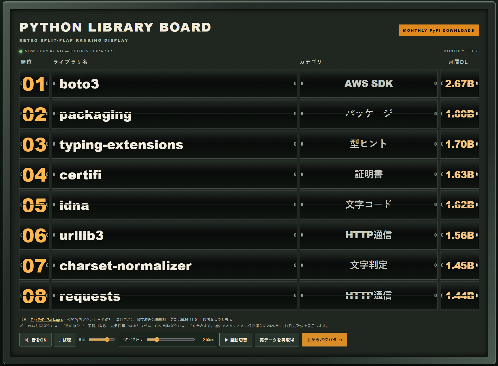

# 🚉 Python Split-Flap Board

**昔の駅の「パタパタ式発車案内板」を、Pythonパッケージの月間ダウンロードランキングとして再現したWeb作品です。**

黒い表示板、中央の分割線、左右の小さな金属リング。上半分の板だけが倒れる動きと、乾いた機械音をブラウザで表現しています。

### ▶ [パタパタ掲示板を体験する（GitHub Pages）](https://kohji-504.github.io/python-split-flap-board/)

> 🔊 効果音はブラウザの仕様により、最初に「音をON」または「♪ 試聴」を押すと有効になります。

## 作品の見どころ

- **上から順番**：1行がめくり終わってから次の行へ
- **不揃いな機械の動き**：各パネルのめくる回数と停止タイミングが異なる
- **レトロな外観**：上下の境界と、左右端の小さなリング
- **音の演出**：Web Audio APIで合成した板の衝突音・軸のクリック音・余韻
- **速度調整**：100〜700ms／枚、初期設定はお気に入りの **210ms／枚**
- **実際の公開統計**：PyPIパッケージの月間ダウンロード上位8件を表示

## 使い方

1. **[公開デモを開く](https://kohji-504.github.io/python-split-flap-board/)**。
2. 「♪ 試聴」または「音をON」で効果音を確認。音量も調整できます。
3. **「上からパタパタ ↻」**を押すと、上の行から順に切り替わります。
4. 速度スライダーで、1枚あたりの切替時間を調整できます。
5. 「▶ 自動切替」で約60秒ごとの演出を開始できます。
6. **「実データを再取得」**で公開データの更新を試みます。

インストール不要です。ダウンロードした `index.html` をブラウザで開いても動きます。

## ランキングの出典と信頼性

**データ元**：[Top PyPI Packages（hugovk）](https://github.com/hugovk/top-pypi-packages)

- 指標は **PyPIパッケージの月間ダウンロード数** です。
- HTMLには **2026年11月1日更新の上位8件**を保存しており、オフラインでも数値を表示できます。
- 「実データを再取得」を押して通信に成功すると、公開先のデータに更新します。取得に失敗した場合は保存済みの数値に戻ります。
- **人気投票や実利用者数ではありません。** CI、ビルド、自動処理などによるダウンロードも含みます。
- ライブラリのカテゴリは画面表示用の簡易説明であり、PyPIの公式分類とは限りません。

## 使用技術

| 技術 | 用途 |
| --- | --- |
| HTML / CSS | 表示板、パネル、3D回転演出 |
| Vanilla JavaScript | 行ごとの切替、速度・自動再生・データ表示 |
| Web Audio API | 外部音声ファイルを使わない機械音の合成 |
| 公開PyPI統計 | ランキングと月間ダウンロード数 |
| GitHub Pages | 静的サイト公開 |

**補足**：テーマはPythonライブラリですが、この作品そのものはPythonを実行せず、ブラウザ上のHTML・CSS・JavaScriptで動作します。

## 制作の経緯

きっかけは、昔の駅にあった「パタパタ式の発車案内板」をもう一度眺めたくなったこと。AIと試作を重ねながら、文字の大きさ、板の境目、金属リング、めくる速さ、機械音、行の切替順序を少しずつ調整しました。

**「動く」だけでなく「眺めて楽しい」表示板**を目指しています。

## 今後の改善案

- デザインとスマートフォン表示の磨き込み
- ランキングの集計月をより分かりやすく表示
- 実データに基づく月別推移・順位変動の追加
- 制作過程の紹介記事やスクリーンショットの掲載

ご意見・不具合報告は [Issues](https://github.com/kohji-504/python-split-flap-board/issues) へどうぞ。

## ライセンス

このリポジトリのオリジナルコードは [MIT License](LICENSE) です。外部の統計データについては、元データ提供元の条件をご確認ください。
